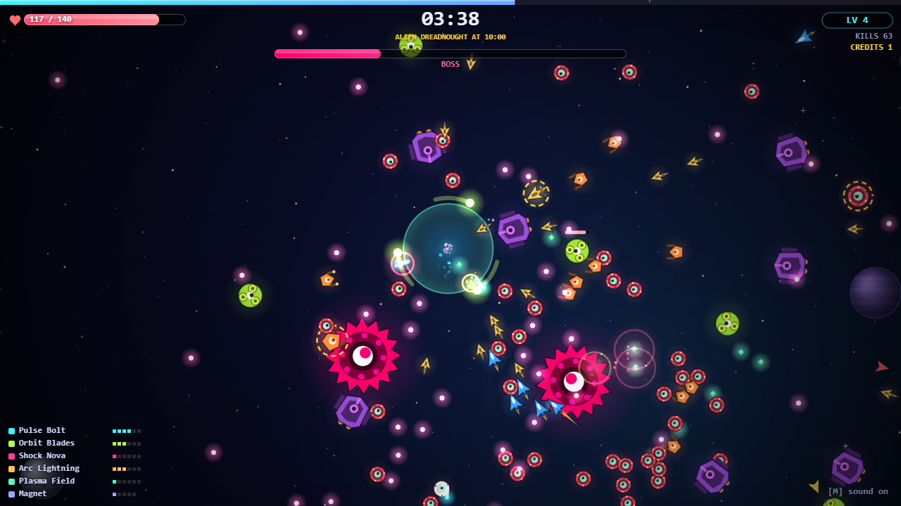
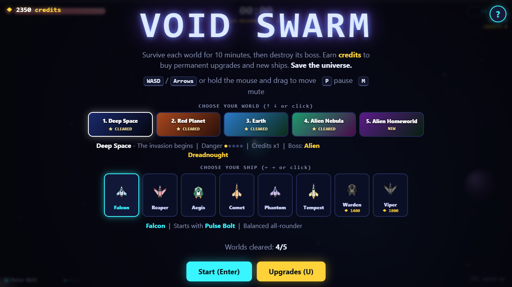
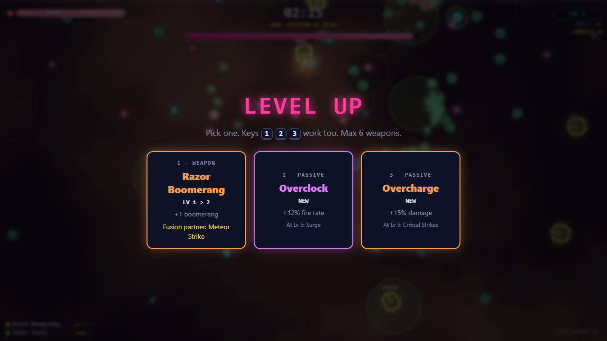
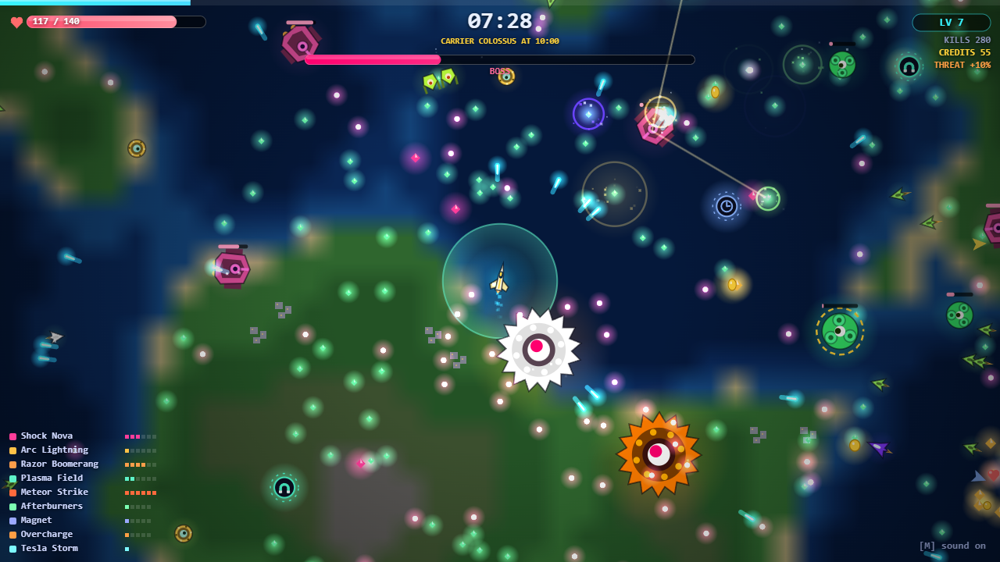
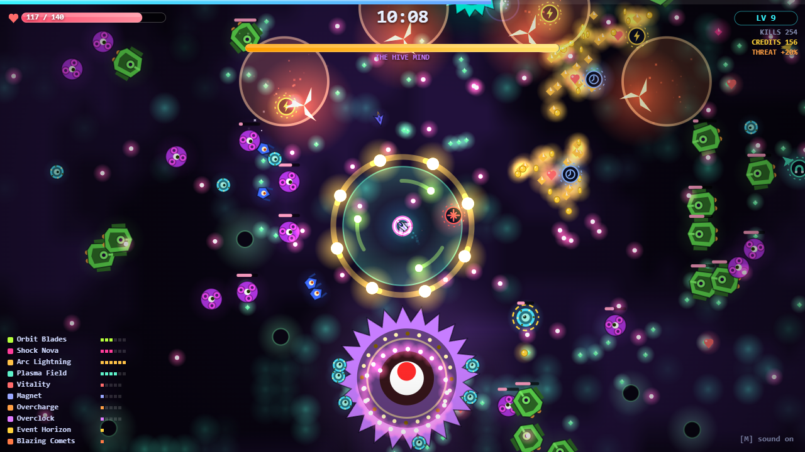
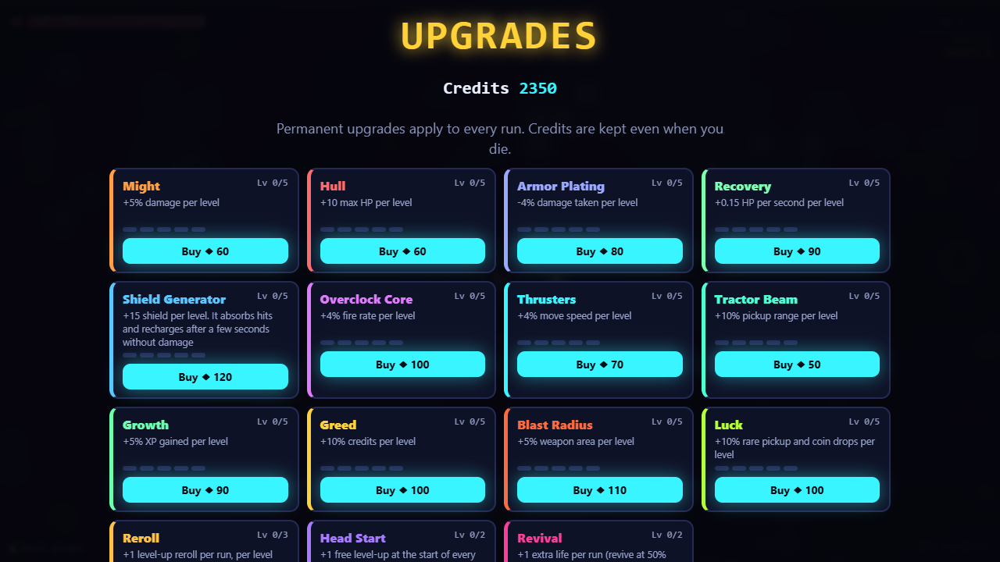

# Void Swarm

A space bullet-heaven roguelite in a single HTML file. Survive 10 minutes against an alien swarm, kill the world's boss, spend your credits on permanent upgrades, and push on to the next world until the Hive Mind falls.

No build step, no dependencies, no assets: open `index.html` in a browser and play.

**[Play in your browser](https://underscorelog.github.io/void-swarm/)**



## Play

Play online at **https://underscorelog.github.io/void-swarm/**, or run it locally:

```bash
git clone https://github.com/underscoreloG/void-swarm.git
```

Then open `void-swarm/index.html` in any modern browser (desktop or mobile).

| Action | Keys |
|---|---|
| Move | `WASD` / arrow keys, or hold the mouse and drag (touch: drag anywhere) |
| Pick a level-up card | `1` `2` `3` or click |
| Pause | `P` / `Esc` |
| Mute | `M` |
| Help | `H` / `?` |
| Choose world / ship (menu) | arrow keys or click |

Weapons fire automatically. Your job is to move, collect XP gems and choose upgrades.

## Features

- **5 worlds**, each a 10:00 run that ends in its own boss: Deep Space, Red Planet, Earth, Alien Nebula and Alien Homeworld (final boss: THE HIVE MIND). Later worlds hit harder and pay more. Beating a boss unlocks the next world, or keep playing in endless mode.
- **8 weapons and 5 passives**, each with 5-6 levels. Maxed passives unlock a mastery perk.
- **4 weapon fusions**: max both parents to Lv 6 and they merge (Event Horizon, Tesla Storm, Blazing Comets, Plague Nebula).
- **8 ships** with their own starting weapon and stat tweaks, bought with credits (Falcon is free).
- **Permanent shop** with 15 upgrades (Might, Hull, Armor, Shield, Revival, Head Start, Reroll and more), plus a free "Refund all".
- **Credits are kept on death**: from kills, boss loot and an end-of-run payout based on time, kills and clears.
- **Save in localStorage**, with export/import save codes to move progress between browsers.

## Screenshots

| | |
|---|---|
|  |  |
| World and ship select | Level-up cards with fusion hints |
|  |  |
| Late run on Earth with a fused weapon | THE HIVE MIND on Alien Homeworld |



## Tech

- One file: `index.html` (HTML + CSS + vanilla JS, Canvas 2D, WebAudio sound effects).
- Tuning lives in plain data tables at the top of the script: `WORLDS` (per-world multipliers and bosses), `META` (shop prices), `SHIPS`, `UPG` (weapons and passives).
- `window.__ns` exposes a small debug/test hook (state, spawning, god mode, time skip) used for automated balance runs and these screenshots.
